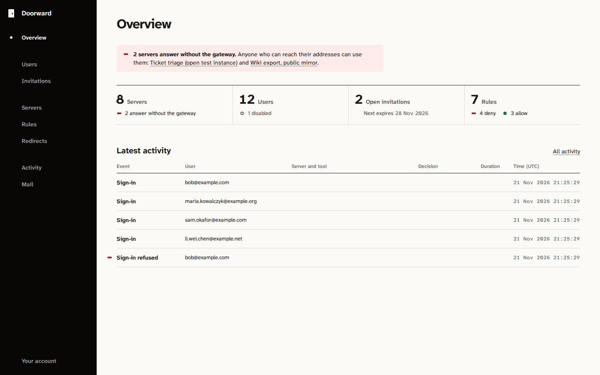
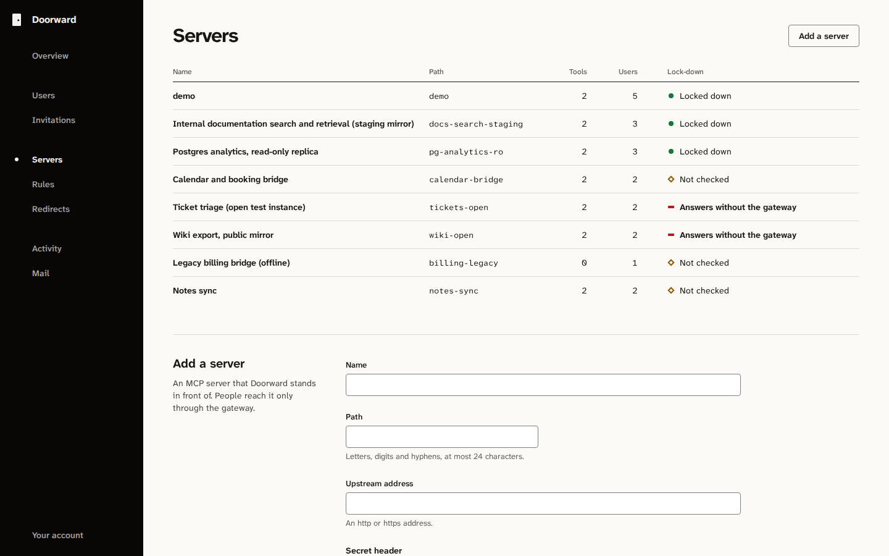
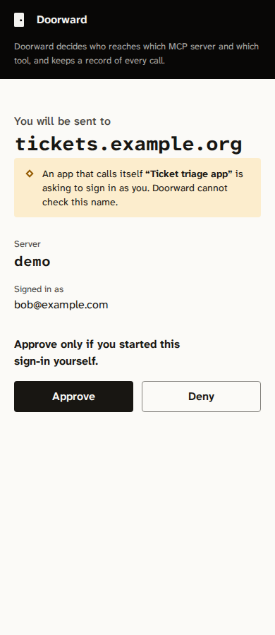

# Doorward

Doorward is an authentication gateway in front of MCP servers hosted anywhere. People sign
in with an email and a password, an admin decides who may use which server and which tool,
and every request is checked before it reaches a server. It ships as one binary with one
SQLite database.

Status: 1.3.0.

> [!TIP]
> Putting Doorward in production for a team? [Both Hands](https://both-hands.com/?utm_source=github&utm_medium=readme&utm_campaign=doorward)
> installs it, secures it and trains your staff. See
> [Help running it in production](#help-running-it-in-production).

<picture>
  <source media="(prefers-color-scheme: dark)" srcset="docs/images/overview-dark.png">
  
</picture>

## What it does

- **One address per server.** Each MCP server you add gets a path, `https://gateway.example.com/<slug>`.
  A combined endpoint, `/mcp`, offers the tools of every server a person may use, named
  `<path>__<tool>`.
- **Its own OAuth server.** MCP clients discover it, send the person to the gateway's own
  sign-in and consent pages, and get tokens that only work at the gateway. The upstream
  servers never see them.
- **Invitations.** The first person to sign up owns the instance. Everyone else comes in
  through a one-time link that expires, and sets or resets their own password by email.
- **Access rules.** Servers are assigned to people. Allow and deny rules cover all tools,
  one server, or one exact tool. A denied tool is left out of the tool list and refused
  when called.
- **Tool switches.** Each person can switch off the tools they do not use, on their account
  page. A switched-off tool leaves their client's tool list, takes no room in the model's
  context window, and a call to it is refused.
- **Per-person credentials.** Where a server needs something from each person, such as an
  API token, an admin declares the header names. The gateway passes on the value the client
  sends, or sends the one that person stored, encrypted, on their account page.
- **Activity log.** Every sign-in, admin change and tool call is recorded with the person
  who made it. The page filters the log by period, event, person, server, tool, client and
  text, and exports every row the filters match as CSV. Rows are kept for
  `limits.activity_days` (90 by default); the export is how to keep more than that.
- **Dashboards.** Charts of the activity log, shared by every admin and the owner and shown on
  the Overview. A new instance starts with a `Usage` dashboard of ten charts. Each figure has a
  Data table with the same numbers, and the charts are drawn by the server with no script. A
  figure can be up to a minute old.
- **Mail.** Raw SMTP, Resend or Mailgun, set from the admin panel.
- **Both protocol generations.** The session form and the stateless form of MCP over HTTP
  are both served.

## Run with Docker

Two Compose files are in this repository. Copy `.env.example` to `.env`, set
`DOORWARD_PUBLIC_URL`, and follow [docs/DOCKER.md](docs/DOCKER.md).

- `compose.caddy.yaml` runs Caddy in front of the gateway, with automatic HTTPS.
- `compose.yaml` runs the gateway alone, on the host's loopback address, for a proxy or
  tunnel you already run.

## Run the binary

The gateway runs on Linux; Windows is not supported. Build it with Rust 1.89 or newer:

```sh
cargo build --release
```

Write a config file. Four settings are enough to start. `doorward.example.toml` shows the
main settings; the settings table in [docs/DOCKER.md](docs/DOCKER.md#settings) lists all of
them, and every setting can also come from an environment variable.

```toml
public_url = "https://gateway.example.com"
listen = "127.0.0.1:8717"
database = "/var/lib/doorward/doorward.db"
trusted_proxies = ["127.0.0.1", "::1"]
```

`trusted_proxies` names the proxy in front; the two loopback addresses fit a proxy on the same host.
The directory of `database` must exist and be writable by the gateway.

Start it. The config file is read only from `--config` or `DOORWARD_CONFIG`.

```sh
./target/release/doorward --config doorward.toml
```

The first start prints a setup code on standard error. Open `/setup`, enter the code, and
the account you create becomes the owner. The code stops working once an owner exists.
The admin panel is at `/admin`; an admin's account page links to it.

Set up mail in the panel before you need it. A lost password, the owner's included, is
reset by email only: there is no command that sets one.

The encryption key for stored secrets is created next to the database, as a file readable
only by its owner. Keep a copy of it outside your backups of the data directory, and restore
it with the database: one is useless without the other. The section
[Custom headers and per-user credentials](#custom-headers-and-per-user-credentials) says why.

Two more commands exist: `doorward unlock` clears a sign-in block for an account, and
`doorward health` checks a running gateway.

## Put HTTPS in front

The gateway speaks plain HTTP and expects a proxy that terminates TLS: Caddy, nginx, a
tunnel, or a load balancer.

- `public_url` must be `https` unless it is a loopback address.
- Set `trusted_proxies` to the addresses of the proxies you run. The gateway then reads the
  visitor's address from `X-Forwarded-For`, which sign-in throttling and rate limits need.
- With an `https` address and no trusted proxy the gateway refuses to start and says why.
  `shared_client_address = true` accepts that every visitor shares one address instead. Then
  everyone shares one set of address rate limits and one sign-in block, so anyone on the
  internet can lock out every user and client by sending junk requests or wrong passwords. Use
  it only on a private network where every visitor is trusted. For an install reachable from
  the internet, list the proxy in `trusted_proxies` and have it send `X-Forwarded-For`, as the
  bullet above describes.

Caddy needs nothing more than the address. It gets the certificate, sends
`X-Forwarded-For` and passes event streams through as they arrive:

```
gateway.example.com {
	reverse_proxy 127.0.0.1:8717
}
```

nginx buffers answers and closes a connection that is silent for 60 seconds unless told
otherwise, which breaks event streams. Inside the `server` block that holds your
certificate:

```
location / {
    proxy_pass http://127.0.0.1:8717;
    proxy_http_version 1.1;
    proxy_set_header Host $host;
    proxy_set_header X-Forwarded-For $proxy_add_x_forwarded_for;
    proxy_buffering off;
    proxy_read_timeout 1h;
}
```

## Add a server and lock it down

In the admin panel, add a server with a name, a path and its upstream address. Then make sure
the server only answers the gateway:

1. Give the server a secret header (a name and a value) and configure the server to refuse
   any request without it. The gateway adds the header to every request it forwards and
   never passes on the visitor's token or cookies. Another header that a client sends
   reaches the server only where an admin declared it and switched on pass-through.
2. Press "Check lock-down" on the server page. The gateway calls the server without the
   secret and shows one of three states. "Locked down" means the server refused a request
   without the secret. "Answers without the gateway" means anyone who can reach its address
   can use it, gateway or not. "Not checked" means the check has not run yet, or the server
   did not answer the check.
3. Where you can, also restrict the server's network so that only the gateway reaches it.

<picture>
  <source media="(prefers-color-scheme: dark)" srcset="docs/images/servers-dark.png">
  
</picture>

The gateway never follows redirects from a server, and only relays the answers an MCP
server is expected to give.

Two things to know about server addresses. An admin can point a server at any address the
gateway can reach, one on your private network included, so give the admin role only to
people you would give that reach. And an `http` address carries the secret header
unencrypted between the gateway and the server: use `https` unless the server runs on the
same host or on a network you trust.

## Custom headers and per-user credentials

Some upstream servers need something from each person, such as an API token. Custom headers
let the gateway supply it. An admin declares the header names a server takes. For each one,
the gateway either passes on the value that the client sends, or sends the value that the
person stored in the gateway. Clients that cannot send custom headers still reach such a
server, because the gateway attaches the stored value.

An admin sets this up on the server's page, under Custom headers. Add up to 8 header names,
such as `X-Api-Key`, and mark each one as required or not. Then switch on one or both of these:

- **Pass these headers through from the client** (pass-through). A declared header that the
  client sends reaches the server with the client's value.
- **Let each person store their own credentials.** Each person saves their values on their
  account page.

`Authorization` can be declared, but the gateway never passes it through from a client. It
can only be stored.

Each person assigned to such a server opens Your account and finds Your credentials. There is
one field for each header. Type the value and press Save credentials. An empty field keeps the
value already stored. To delete one, tick Remove the stored credential. The field never shows
a stored value again. The page shows only the date it was set. Values are saved encrypted.
Changing or removing a stored credential ends that person's open sessions with the server; a
client that does not reconnect by itself has to be reconnected.

If a required header has no value for a person, nothing is sent to that server for that
person. The gateway answers for the server itself, never with HTTP 401 or 403, so a client does
not mistake it for a failed sign-in. The client connects, the tool list is the gateway's stored
list for that server under the person's rules, and a call to a tool on that list returns a tool
error that names the server and the account page, so the person knows where to add the value.
Where storing is switched off, the error names the header instead. This holds on the server's
path and on the combined endpoint `/mcp`, and the other servers keep working. Once the value is
stored, the same connection keeps working without a new sign-in. On the server's path the
gateway keeps serving that connection itself, tool lists and tool calls only, until the client
reconnects. A connection that holds no copy of the person's key, such as one made before the
person had stored anything at all, may be asked to reconnect instead; the error says so. The
account page marks each server that still needs values.

The stored list is what the server answered the last time its tools were refreshed. A server
that answers its tool list only with credentials has an empty list until someone whose
credentials work refreshes it: store your own credentials on Your account, then press Refresh
tools on the server's page, before you invite people. Until then a person who connects sees no
tools.

The gateway deletes stored credentials when:

- a password is reset by email;
- the server's upstream address changes, for every person;
- a declared header is removed, and renaming a header counts as removing it;
- an admin unassigns the person from the server;
- the server is deleted;
- the gateway cannot open a person's key at a password change or a sign-in.

A password change normally keeps them. If the gateway cannot open a person's key at a password change or a sign-in, it deletes that person's stored credentials and records it in the activity log.

Turning off "Let each person store their own credentials" for a server stops the gateway from
attaching stored values to calls to it. It does not delete them. What people stored stays until
they delete it with Delete my stored credentials on their account page, or until the server's
address changes or one of its headers is removed.

Two limits of sharing a server between people:

- On the combined endpoint `/mcp`, a header a client passes goes to every server that declares
  that name and passes headers through, not only to the one being called.
- The gateway keeps one cached tool list for each server, shared by all its users, and shown
  to people who have not stored a credential yet. A server whose list depends on the caller's
  credentials shows the list of whoever fetched it last.

### What the encryption covers

Each person's values are sealed under a data key. Only that person's password opens the key,
or a live session or token of theirs. The server key in the key file seals each of those
wraps as well.

Covered: a copy of the database, its write-ahead log and the key file together open no stored
credential without that person's password, or a live session or token of theirs. An admin
cannot read them either. The admin panel shows only whether a person has a value.

Not covered:

- Someone running code inside the live gateway sees credentials as calls pass through it.
- A password guessed offline from a stolen database. Argon2id makes each guess slow, and a
  long random password stops it.
- A stolen live token or session, together with the database.
- An admin who points a server at another address and waits for people to store their values
  again. Changing the address deletes what was stored, but the values stored next go to the
  new address.
- An upstream that echoes a credential back in its answer. The gateway does not check what an
  upstream answers.
- The refresh replay window. Inside it (`lifetimes.refresh_replay_seconds`, 30 seconds by
  default) a rotated refresh token together with a copy of the database still opens that
  person's key.
- Values held in memory. The gateway clears them on a best effort basis, and a value lives in
  memory for about the length of a request.

If you suspect that a stored credential was stolen, rotate the upstream credential at the
upstream server, then have each person store the new value. The gateway cannot tell that a
credential was stolen.

Keep the key file out of backups of the data directory. Its path is set by the `key_file`
setting (`DOORWARD_KEY_FILE`), and by default it sits next to the database. Keep a copy
somewhere else, and restore it with the database. `DOORWARD_KEY` holds the key itself rather
than a file, so keep it out of backups too.

## Give people access

Invite a person from the invitations page of the admin panel (`/admin/invitations`). Tick the
servers they should reach and add their personal rules on the invitation's page; these apply
from their first sign-in, and nothing applies before the account exists. Assign servers to
them later from their page or from the server's page. An admin can do this for
anyone, the owner and other admins included; only the owner changes roles and mail
settings. With no matching deny rule, every tool of an assigned server is allowed. Rules
allow or deny all tools, one server, or one exact tool, for one person or for everyone. The tool
names a rule form suggests are the tools of the server picked above it; press Show its tools
after choosing another server. A client picks up a change to a rule when it reconnects or
refreshes its tools; a call that a rule denies is refused at once.

## Connect a client

Give the client the address of one server (`https://gateway.example.com/<slug>`) or the
combined endpoint (`https://gateway.example.com/mcp`). Any MCP client that supports
streamable HTTP and OAuth should work: it finds the sign-in pages by itself, and both
client registration methods are supported.

Claude Code:

```sh
claude mcp add --transport http <name> https://gateway.example.com/<slug>
claude mcp login <name>
```

Codex:

```sh
codex mcp add <name> --url https://gateway.example.com/<slug>
codex mcp login <name>
```

The browser opens the gateway's sign-in page, then a consent page that names the client,
the server and the signed-in person. Approve only a sign-in you started yourself.

<picture>
  <source media="(prefers-color-scheme: dark)" srcset="docs/images/consent-dark.png">
  
</picture>

Each person sees their connected clients on their account page and can disconnect one
there. The same page holds their tool switches under Your tools; a client picks up a change
when it reconnects or refreshes its tools. Claude Code, Codex and the Cursor command line
client were run against the gateway.

## Limits worth knowing

- Five wrong passwords for one account from one address block further tries on that
  account from that address for 15 minutes. Other limits and all defaults are in
  [docs/DOCKER.md](docs/DOCKER.md#rate-limits).
- A browser page on another origin cannot call the MCP paths unless its origin is listed
  in `allowed_origins`.
- A server's answer larger than `tools_list_bytes` (4 MiB by default) is not relayed. A larger
  JSON answer, such as a tool list or a tool result, gets a `502`. A larger event in a stream
  ends that stream. On the combined endpoint, a server that is too large is left out of the
  tool list.
- Access tokens last 60 minutes and refresh tokens rotate. A refresh token presented again
  within 30 seconds gets the same new pair, which covers a lost answer; presented later, it
  ends that client's connection.

## What the gateway does not do

- Every user reaches a server with one shared secret header per server, when the server has
  one. Where an admin declared custom headers, each person's own values for them are sent as
  well. Per-user permissions exist only in the gateway. Anything the server caches or stores
  per caller is shared.
- A server's cached tool list is shared by its users, even when each of them sends different
  credentials, and it is shown to people who have not stored a credential yet.
- Allow and deny rules cover tools only. A server's resources and prompts are switched on or
  off per server. When a switch is on, they pass for every user assigned to that server.
- The combined endpoint `/mcp` puts the tool descriptions of every assigned server in one list.
  A compromised server can word its descriptions to steer an agent toward other servers' tools.
- The lock-down check proves that the server refuses a request without the secret. It cannot
  prove that the server never reveals the secret, for example by echoing request headers back.
  Keep the network restriction in step 3 as well.
- A new deny rule applies to the next call. It does not end a call that is already running.
- A tool call still succeeds when its activity row cannot be written, for example on a full disk.
- `Mcp-Param-*` request headers go to the server as the client sent them. The gateway does not
  compare them with the message, and it decides nothing from them. The MCP specification
  leaves that check to the server.

## Run the tests

`./check.sh` runs formatting, lints, every test, the dependency audits and the repository
hygiene scan, and prints `CHECK PASS` when all of them pass.

The proof scripts (`scripts/prove-*.sh`, with helpers in `scripts/prove/`) drive real clients
and real HTTP against a throwaway gateway. [CONTRIBUTING.md](CONTRIBUTING.md) describes them.

## Help running it in production

Doorward is free and open source, and everything in this README is enough to run it
yourself. If your organization would rather not do it alone,
[Both Hands](https://both-hands.com/?utm_source=github&utm_medium=readme&utm_campaign=doorward)
is the consultancy of Doorward's author and offers paid help:

- **Installation and hardening.** Doorward on your own infrastructure, behind HTTPS, with
  backups, monitoring and a tested restore.
- **Configuration.** Your MCP servers added and locked down, access rules per team, and
  your people's clients moved over.
- **Training.** Admins who can run the gateway, and staff who use MCP tools in production
  safely.
- **Security review.** A second pair of eyes on an install you already have.

Service in English and French.
[Tell Both Hands what you need](https://both-hands.com/?utm_source=github&utm_medium=readme&utm_campaign=doorward).

Bugs and questions about Doorward itself stay free and public: see below.

## Questions and bugs

Bugs and questions go to the repository's issue tracker. Security reports do not: see
[SECURITY.md](SECURITY.md) for how to make one.

## More

- [docs/DOCKER.md](docs/DOCKER.md): containers, every setting, backups, upgrades.
- [docs/DESIGN.md](docs/DESIGN.md): how the gateway is built and why.
- [docs/INTERFACE.md](docs/INTERFACE.md): every page and endpoint.
- [docs/TESTS.md](docs/TESTS.md): the test catalogue.
- [SECURITY.md](SECURITY.md): how to report a vulnerability, and the known limits.
- [CONTRIBUTING.md](CONTRIBUTING.md): how a change is made and checked.

## License

Licensed under MIT OR Apache-2.0. See `LICENSE-MIT` and `LICENSE-APACHE`.

The bundled fonts, Atkinson Hyperlegible Next and Atkinson Hyperlegible Mono, are licensed
under the SIL Open Font License 1.1, with the license texts in `assets/fonts/`.
